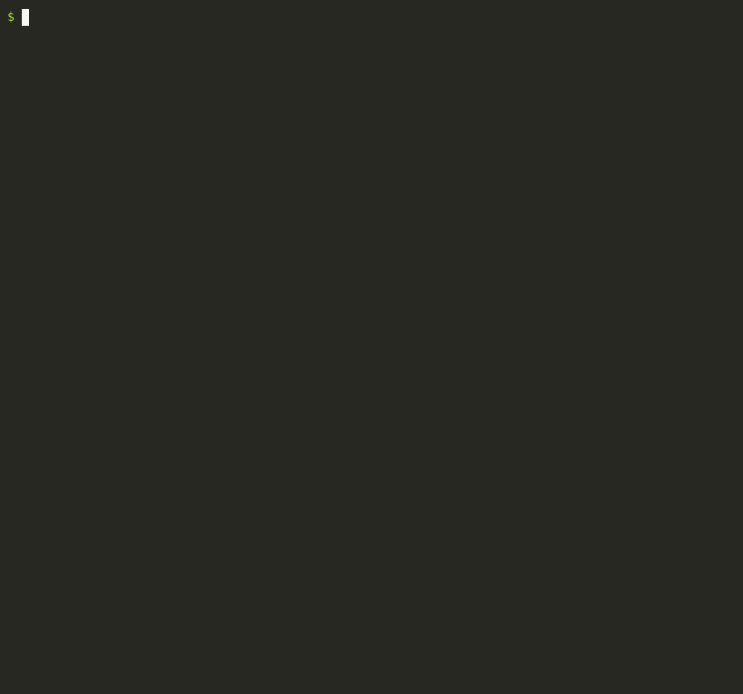

<h1 align="center">slowrc</h1>

<p align="center"><b>Why does your terminal take so long to open?</b><br>
slowrc times your shell's startup, shows exactly which lines of your <code>.zshrc</code> / <code>.bashrc</code> cost the most, and fixes the slow ones safely.</p>

<p align="center">
  <a href="https://pypi.org/project/slowrc/"></a>
  <a href="https://github.com/ArkaKhorchidian/slowrc/actions/workflows/ci.yml"></a>
  
  <a href="LICENSE"></a>
</p>

```bash
uvx slowrc          # see where the time goes
uvx slowrc --fix    # fix it
```

<p align="center">
  
  <br><sub>Demo run on a sandboxed home directory with a typical setup: nvm, pyenv, Homebrew, kubectl completions.</sub>
</p>

## How it works

1. **Times** your real startup a few times (median).
2. **Traces** one startup with the shell's own tracing (timestamps on every line it runs), then charges
   each line's time to the line in *your* file that caused it. For example, 250 ms deep inside `nvm.sh` shows up as
   `~/.zshrc:3`. Tracing overhead is measured and subtracted.
3. **Recognises** the usual suspects and how to fix each one.
4. With `--fix`: **backs up** your files, applies the fixes, then **starts a fresh shell and checks it behaves exactly the same**:
   - it still starts cleanly
   - nothing went missing from `PATH`
   - `node` resolves to the same binary
   - no new errors appear

   If anything differs, every file is restored automatically.

## What it fixes

| | Typical saving | What slowrc does |
|---|---|---|
| **nvm** | 200–800 ms | Puts your default Node straight on `PATH`; nvm itself loads the first time you run `nvm` |
| **`eval "$(tool init)"`** for pyenv, rbenv, brew shellenv, starship, zoxide, direnv, mise, atuin, fzf, thefuck, … | 30–300 ms each | Caches the generated script; it regenerates automatically when the tool is updated |
| **`source <(kubectl completion zsh)`** and other generated completions (helm, gh, docker, uv, poetry, …) | 50–200 ms each | Same caching |
| **`$(brew --prefix formula)`** | 100–500 ms each | Replaces it with the path it prints |
| **compinit** | 20–150 ms | Runs its full check at most once a day, reusing its cache otherwise |

It also points out what it won't touch automatically: conda's base environment, oh-my-zsh plugin weight,
SDKMAN!, RVM, a global `compinit` in `/etc/zsh/zshrc`, and any other line over 50 ms.

Only init commands whose output never changes between sessions get cached. Things like `ssh-agent`,
`keychain` or `fnm env` are left alone.

## Safety

- **Nothing is changed without `--fix`.** The report alone is read-only.
- Every edited file gets a timestamped backup next to it, and **`slowrc --undo`** restores them byte for byte.
- Each change is marked with a `# slowrc:` comment saying what the line used to be.
- System files (`/etc/...`) are never edited.

## Options

```bash
slowrc --shell bash          # default: your $SHELL
slowrc --login / --no-login  # default: login on macOS, interactive on Linux (what terminals use)
slowrc --runs 20             # more timing runs
slowrc --json                # machine-readable report
```

zsh and bash on macOS and Linux. Line-by-line profiling of bash needs bash 5+ (macOS ships 3.2: `brew install bash`).
If something in your startup files waits for input (like tmux auto-attach), it can skip itself when `$SLOWRC` is set.

## License

MIT
